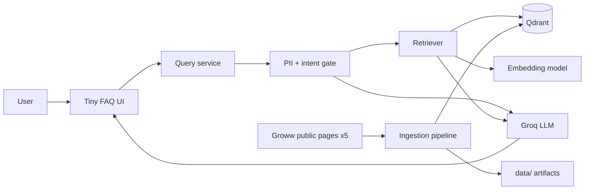
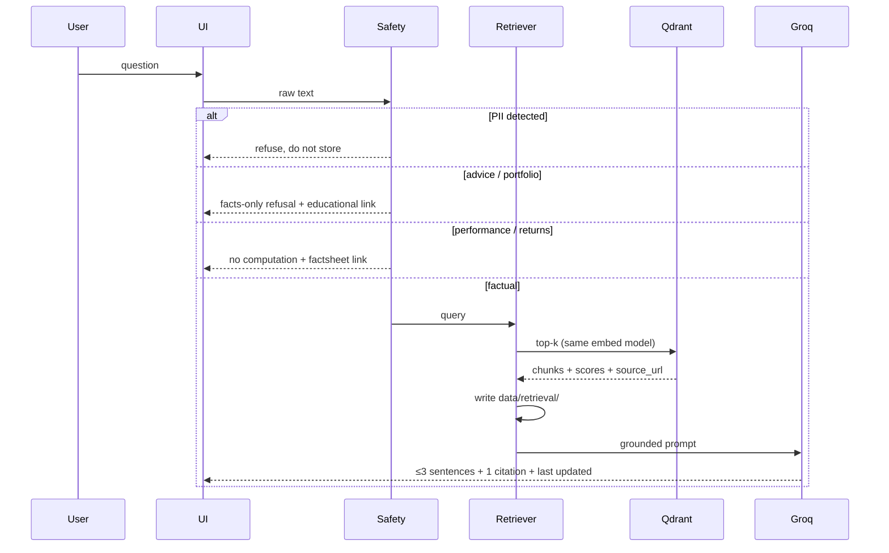

# Architecture

**Product:** Groww Mutual Fund FAQ Assistant  
**Source:** [PRD.md](PRD.md)  
**Version:** 1.0  
**Date:** 2026-11-01

---

## 1. Purpose

This document describes how the facts-only RAG prototype is structured: components, data flow, persisted artifacts, configuration, and request handling.

Design principles from the PRD:

- **RAG only** — answers come from retrieved chunks of five Groww public pages, not from model memory.
- **Stage visibility** — load, chunk, embed, retrieve, and generate each write inspectable artifacts.
- **Config over code** — URLs, chunking, embeddings, Qdrant, and top-k live in config; Groq model and API key live in `.env`.
- **Safety first** — no advice, no return math, no PII, one citation per answer.

---

## 2. System context



External systems:

| System | Role |
|--------|------|
| Groww.in (5 URLs only) | Sole scrape targets |
| Hugging Face `sentence-transformers/all-MiniLM-L6-v2` | Embeddings for ingest and query |
| Qdrant (embedded local mode or server) | Vector store |
| Groq API | Answer generation |
| Optional official links (AMFI, SEBI, factsheet, Groww help) | Citation/education URLs in prompts/config — **not scraped** unless added later |

---

## 3. High-level components

```
┌─────────────────────────────────────────────────────────────┐
│ UI (welcome, 3 examples, disclaimer, chat)                  │
└─────────────────────────────┬───────────────────────────────┘
                              │
┌─────────────────────────────▼───────────────────────────────┐
│ Query service                                               │
│  PII filter → intent (answer / refuse / factsheet-redirect) │
│  → retrieve top-k → prompt + Groq → format answer           │
└─────────────┬───────────────────────────────┬───────────────┘
              │                               │
              ▼                               ▼
     Embedding model                    Groq (model from .env)
              │
              ▼
         Qdrant collection
              ▲
              │
┌─────────────┴───────────────────────────────────────────────┐
│ Ingestion (run separately, phase by phase)                  │
│  load → chunk → embed → upsert                              │
└─────────────────────────────────────────────────────────────┘
```

**Ingestion** and **query** share config: same embedding model, same Qdrant location and collection.

---

## 4. Proposed layout

Runnable stages stay separate so the demo can stop after any phase.

```
.
├── PRD.md
├── architecture.md
├── README.md
├── config.yaml                 # URLs, chunking, embeddings, qdrant, top-k, educational links
├── .env                        # GROQ_API_KEY, GROQ_MODEL (not committed)
├── .env.example
├── sources.md                  # 15–25 URL source list (deliverable)
├── sample_qa.md                # 5–10 Q&A (deliverable)
├── src/
│   ├── config.py               # load config.yaml + .env
│   ├── ingest/
│   │   ├── load.py             # fetch 5 URLs, write data/raw + data/loaded
│   │   ├── chunk.py            # section-aware chunks → data/chunks
│   │   └── embed.py            # embeddings → Qdrant + data/embeddings index
│   ├── query/
│   │   ├── safety.py           # PII + advice/performance intent
│   │   ├── retrieve.py         # embed query, Qdrant top-k, write data/retrieval
│   │   ├── generate.py         # Groq + prompt
│   │   └── pipeline.py         # orchestrate query path
│   └── ui/
│       └── app.py              # Streamlit (or equivalent)
├── prompts/
│   ├── system.txt
│   └── refuse.txt
└── data/                       # persisted stage artifacts (gitignored except samples)
    ├── raw/
    ├── loaded/
    ├── chunks/
    ├── embeddings/
    ├── retrieval/
    └── qdrant/
```

UI choice for v1: **Streamlit** (meets welcome / examples / disclaimer with little surface area). Alternative: FastAPI + static HTML. Notebook is fallback if an app is not viable.

---

## 5. Ingestion pipeline (phases 1–3)

Each phase is a CLI step. Output of phase *n* is input of phase *n+1* and is written to disk.

### 5.1 Phase 1 — Data loading

**Input:** `config.yaml` source list (exactly five URLs).  
**Process:**

1. HTTP GET each URL. Do **not** follow or scrape internal links.
2. Save raw HTML: `data/raw/{page_type}.html`.
3. Extract readable text and FAQ fields (scheme name, expense ratio, exit load, min SIP, lock-in, riskometer, benchmark, AMC overview).
4. Write `data/loaded/{page_type}.json`:

```json
{
  "page_type": "elss",
  "title": "HDFC ELSS Tax Saver Fund Direct Plan Growth",
  "source_url": "https://groww.in/mutual-funds/hdfc-elss-tax-saver-fund-direct-plan-growth",
  "fetched_at": "2026-11-01T11:30:00Z",
  "text": "...",
  "fields": {
    "expense_ratio": "...",
    "exit_load": "...",
    "min_sip": "...",
    "lock_in": "...",
    "riskometer": "...",
    "benchmark": "..."
  }
}
```

`fetched_at` is the timestamp shown as **Last updated from sources**.

### 5.2 Phase 2 — Data chunking

**Strategy (default, overridable in config):** section-aware, not naive fixed windows.

Rationale: pages are small and fact-dense. Splitting a key-value pair from the scheme name would break retrieval.

Rules:

- One logical section per chunk where possible (e.g. “fund facts”, “AMC overview”, “statements/help”).
- Keep scheme identity and related facts in the **same chunk**.
- Optional character cap + modest overlap so headings stay with values.
- If extracted `fields` exist, emit a **facts chunk** that serializes those key-values plus scheme title (high-precision FAQ retrieval).

Chunk record:

```json
{
  "id": "elss-facts-001",
  "text": "HDFC ELSS Tax Saver ... Expense ratio: ... Lock-in: 3 years ...",
  "metadata": {
    "source_url": "https://groww.in/mutual-funds/hdfc-elss-tax-saver-fund-direct-plan-growth",
    "page_type": "elss",
    "title": "HDFC ELSS Tax Saver Fund Direct Plan Growth",
    "fetched_at": "2026-11-01T11:30:00Z",
    "section": "facts"
  }
}
```

`page_type` ∈ `amc | large_cap | flexi_cap | elss | mid_cap`.  
Write `data/chunks/chunks.jsonl`.

### 5.3 Phase 3 — Data embedding

**Input:** `data/chunks/chunks.jsonl`.  
**Model:** `sentence-transformers/all-MiniLM-L6-v2` (config).  
**Store:** Qdrant client (embedded local mode by default, or a server URL from config).

- Collection name and storage location from config (`data/qdrant/` in local mode, collection e.g. `mf_faq`).
- Upsert one point per chunk: embedding vector, payload `document` (chunk text), payload metadata, and `chunk_id` (Qdrant ids are deterministic UUIDv5 values).
- Write a lightweight index for the demo: `data/embeddings/manifest.json` (ids, model name, dim, collection, count). Do not dump full vectors unless needed for inspection.

Re-ingest is idempotent: wipe or upsert by stable chunk `id`.

---

## 6. Query pipeline (phases 4–5)



### 6.1 Safety gate (before retrieval)

| Signal | Action |
|--------|--------|
| PAN, Aadhaar, account number, OTP, email, phone | Refuse; do not log or persist the message |
| Buy/sell, “should I”, “best fund”, portfolio allocation | Refusal template + one educational official link |
| Returns, CAGR, “which performed better” | Do not compute/compare; link official factsheet from config |

Intent can be regex/keyword first (cheap, deterministic for the demo) with optional LLM classify later. Do not send PII to Groq.

### 6.2 Phase 4 — Retrieval

- Embed the query with the **same** MiniLM model.
- Query the **same** Qdrant collection, `top_k` from config.
- Optional metadata filter if the query names a scheme (`page_type`).
- Persist `data/retrieval/{timestamp}.json`: query, ids, scores, `source_url`s, chunk previews.

### 6.3 Phase 5 — Generation

- Provider: Groq. Model: `GROQ_MODEL` in `.env` (assignment default `qwen/qwen3.8-27b`; confirm Groq id at implement time).
- Ground **only** in retrieved chunk text.
- If chunks do not support the fact: say so; still attach an official/educational link when possible. Never invent numbers.
- Choose **one** citation: highest-scoring chunk whose content supports the stated fact (`metadata.source_url`).
- `Last updated from sources:` = max `fetched_at` among chunks used (or that citation’s `fetched_at`).

**Answer shape:**

1. ≤ 3 sentences of fact (or refusal).  
2. One URL.  
3. `Last updated from sources: <ISO date>`.  
4. UI always shows: **Facts-only. No investment advice.**

---

## 7. Prompting

`prompts/system.txt` (W2):

- You are a facts-only mutual fund FAQ assistant for listed HDFC schemes on Groww public pages.
- Use only the provided context. If the fact is missing, say you do not have it in the ingested pages.
- Never give buy/sell/portfolio advice.
- Never compute or compare returns.
- Answers ≤ 3 sentences.
- Always output one source URL from context metadata.
- Always output last-updated from context `fetched_at`.

Refusal and factsheet-redirect can skip the LLM (templates) for predictability, or use a short LLM rewrite of the template. Templates are preferred for advice/PII so behavior is stable in the demo.

---

## 8. Configuration

### `config.yaml`

| Key | Used by |
|-----|---------|
| `sources[]` (`page_type`, `title`, `url`) | Load |
| `chunk.strategy`, `chunk.size`, `chunk.overlap` | Chunk |
| `embedding.model` | Embed + retrieve |
| `qdrant.mode`, `qdrant.path`, `qdrant.url`, `qdrant.collection` | Embed + retrieve |
| `retrieval.top_k` | Retrieve |
| `llm.provider` | Generate (`groq`) |
| `links.factsheet`, `links.education`, `links.statements_help` | Refusals / performance redirect / “how to download statement” citation if not in corpus |
| `ui.welcome`, `ui.examples[]`, `ui.disclaimer` | UI |

Changing embedding model or collection requires **re-running embed**. Changing `top_k` does not.

### `.env`

```
GROQ_API_KEY=
GROQ_MODEL=qwen/qwen3.8-27b
```

Optional later: Gemini, OpenAI, Anthropic, Mistral via `llm.provider` + extra env keys. v1 is Groq only.

---

## 9. UI

Minimum (PRD §5.2):

- Welcome line from config.
- Three example questions as clickable chips.
- Persistent disclaimer: **Facts-only. No investment advice.**
- Input box; answer panel with text, citation link, last-updated.
- Optional demo panel: last retrieval JSON (ids, scores, URLs) so RAG stages are visible in the app as well as on disk.

Do not persist chat logs that might contain PII. In-session memory only.

---

## 10. Data stores and artifacts

| Path | Stage | Contents |
|------|--------|----------|
| `data/raw/` | Load | HTML |
| `data/loaded/` | Load | Extracted JSON + `fetched_at` |
| `data/chunks/` | Chunk | JSONL chunks + metadata |
| `data/embeddings/manifest.json` | Embed | Model, count, ids |
| `data/qdrant/` | Embed | Qdrant persist |
| `data/retrieval/` | Retrieve | Per-query traces |

These artifacts are a **deliverable**. Keep them local; do not commit secrets or user queries.

---

## 11. Security and limits

- Scraper allowlist = the five config URLs. No crawler.
- No PII in logs, Qdrant, or retrieval files.
- Public HTTP only; no Groww authenticated APIs.
- Stale numbers: freshness is `fetched_at`, not live NAV.
- Layout changes on Groww can break extractors; keep selectors in the load module, not scattered.
- MiniLM + five pages: retrieval is adequate for FAQ facts, not for open-ended research.

---

## 12. Runtime vs batch

| Mode | Command (illustrative) | When |
|------|------------------------|------|
| Batch ingest | `python -m src.ingest.load` then `chunk` then `embed` | First run, source refresh |
| Online query | Streamlit / `pipeline.ask(question)` | User questions |
| Demo video | Ingest once, then 5–10 sample questions | If hosting is unavailable |

---

## 13. Mapping to PRD success criteria

| PRD criterion | Architecture |
|---------------|--------------|
| Five pages only | Allowlisted `config.yaml` sources; loader never follows links |
| One citation, ≤3 sentences, last-updated | Generator contract + chunk metadata |
| Advice / performance policy | Safety gate before retrieve/LLM |
| Inspectable RAG | `data/*` per stage + optional UI retrieval panel |
| Config-driven embeddings/Qdrant | `config.yaml` |
| Groq model from env | `GROQ_MODEL` |
| Tiny UI + disclaimer | Streamlit app + config copy |
| No PII stored | Safety filter; no query persistence |
